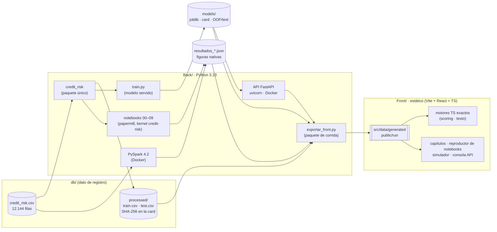
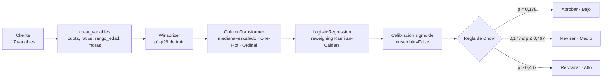
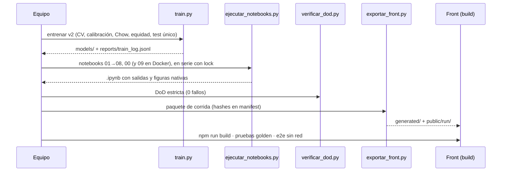

# 04 · Arquitectura (v2.0.0)

> Describe el sistema tal como existe en el código. Las decisiones están en `docs/gestion/adr/`
> (ADR-001 a ADR-008) y los criterios de calidad en `docs/gestion/definicion_de_hecho.md`.

## 1. Vista general

**Principios**
1. **Una sola fuente de verdad.** `credit_risk` contiene toda la lógica. `train.py`, los notebooks, la API y el exportador importan de ahí, sin duplicar nada.
2. **Test se usa una sola vez**, en la evaluación final de `train.py` (ADR-001).
3. **El front no depende del back.** Lleva precargados los resultados reales y reproduce la corrida. Sus motores TypeScript son ports exactos del modelo, verificados con casos golden (ADR-004).
4. **Todo el back es Python.** Docker solo se usa como runtime (ADR-005, ADR-008).

## 2. Paquete `credit_risk`

| Módulo | Responsabilidad |
|---|---|
| `config` | Rutas relativas a la raíz, semilla 42, columnas, reglas de limpieza, costos de decisión, grupos de equidad, umbrales de PSI y versión única (`__version__`). |
| `data` | `validar_dataset` (contrato), `limpiar` (reglas fijas), `dividir` (80/20 estratificado), `aprender_imputacion` (solo train), `preparar_procesados` y `hash_archivo`. |
| `features` | `crear_variables` (6 derivadas), `Winsorizer` (p1-p99 ajustado en train), `build_preprocessor` (One-Hot, Ordinal y StandardScaler) y `build_pipeline`. |
| `models` | Catálogo de modelos, `metricas`, `curvas`, `calibrado` (sigmoide, `ensemble=False`), `umbrales_chow`, `decidir` y `banda`, `costo_esperado` y `sensibilidad`. |
| `fairness` | `grupo_edad`, `tabla_grupos`, DI con IC bootstrap, `auditar`, `pesos_kamiran_calders` y el meta-estimador `Reweighing`. |
| `explain` | `Explicador` (contribuciones exactas en log-odds calibrados) e `importancia_permutacion`. |
| `monitoring` | PSI por variable y del puntaje, traducido a la acción estable, vigilar o recalibrar. |
| `prediccion` | `ArtefactoModelo` (modelo, explicador, umbrales y versión), `cargar_artefactos` y `predecir_cliente`. |
| `nlp` / `nlp_avanzado` | Parte liviana: TF-IDF y léxico, usada por la API. Parte pesada: BERT, sentence-transformers y GPT-2, solo en notebooks. |
| `dl` | Redes en TensorFlow/Keras: MLP, CNN 1D y GRU sobre el texto. |
| `entrenamiento` | Protocolo completo del modelo servido. |
| `schemas_resultados`, `reporting`, `notebook`, `demo` | Contratos de resultados, estilo y figuras nativas, arranque de los notebooks y clientes de demostración. |

## 3. Pipeline del modelo servido

`sexo` se recibe solo para auditoría y no entra al modelo. Los umbrales salen de los costos por unidad de exposición: LGD 0,45, margen 0,15 y revisión 0,08 (ADR-002).

## 4. Contrato de la API (v2)

| Método | Ruta | Respuesta |
|---|---|---|
| GET | `/health` | `{status: "ok" \| "degradado", modelo_version, modelo_cargado, api_version}` |
| GET | `/model/info` | Model card completa (protocolo, métricas de test, umbrales, equidad, monitoreo y limitaciones) |
| POST | `/predict` | `{probabilidad_impago, decision, banda_riesgo, prediccion, etiqueta, umbrales, factores_principales[{variable, contribucion, efecto}], modelo_version}` |
| POST | `/predict/batch` | De 1 a 1.000 clientes → `{resultados, total}` |
| POST | `/predict/text` | `{probabilidad_impago_texto, banda_riesgo, sentimiento, modelo}` |

- **Validación:** Pydantic v2 con `extra="forbid"`. Un campo desconocido o fuera de rango responde **422** con `loc` apuntando al campo.
- **Disponibilidad:** sin artefactos el servicio responde **503** y `/health` informa "degradado".
- **Trazabilidad y orígenes:** cada respuesta lleva `X-Request-ID`. CORS se configura con `CORS_ORIGINS`.

## 5. Flujo de una corrida completa

