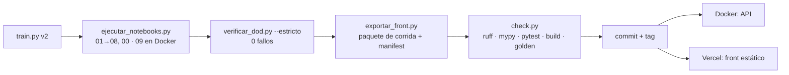

# 05 · Despliegue y operación (IA3.5, R4)

> La API se despliega con **Docker**, que es lo que exige IA3.5 ("Docker o nube"), y corre en local. El **front es
> estático y autónomo**: Vercel solo sirve archivos y nunca llama a la API (ADR-004). La guía de nube se ejecuta
> únicamente si hay credenciales y con confirmación explícita.

## 1. Flujo de una publicación



## 2. API con Docker (local)

La imagen se construye desde `Back/` con estas propiedades:
- Base `python:3.10-slim`.
- Dependencias exactas de `requirements-api.lock`, generadas por `scripts/generar_lock_api.py` para Linux.
- Paquete `credit_risk` instalado con `--no-deps`.
- Solo los tres artefactos servidos.
- Usuario sin privilegios (uid 10001), sistema de archivos de solo lectura y HEALTHCHECK sobre `/health`.

```bash
cd Back
docker compose up --build -d          # http://127.0.0.1:8000/docs
docker compose ps                     # estado "healthy"
curl -s http://127.0.0.1:8000/health
curl -s -X POST http://127.0.0.1:8000/predict -H "Content-Type: application/json" --data-binary @api/ejemplo_request.json
docker compose down
```

Imagen: `riesgo-credito-api:2.0.0`. La versión de la imagen es la del paquete, y la verifica `tests/test_proyecto.py`.

## 3. PySpark con Docker (notebook 09, IA3.6)

`Back/docker-compose.spark.yml` usa `quay.io/jupyter/pyspark-notebook:2026-10-19` (Spark 4.2, Java 21) y ejecuta el
notebook con papermill y el kernel `credit-risk`: `python scripts/ejecutar_notebooks.py 09`. Ver ADR-005.

## 4. Front estático (Vercel)

- **Configuración:** `vercel.json` instala y construye solo `Front/` (`npm --prefix Front ci && npm --prefix Front run build`) y publica `Front/dist`.
- **Cabeceras:** `Cache-Control: immutable` para `/run/*` y `/assets/*`, y una CSP con `connect-src 'self'` que impide cualquier llamada a otro origen.
- **Exclusiones:** `.vercelignore` deja fuera `.env*` (contiene tokens), `Back/`, `db/` y `docs/`.
- **Requisito previo:** el paquete de corrida (`Front/src/data/generated`, `Front/public/run`) debe estar commiteado. Se genera en local con `exportar_front.py` después de la corrida real.
- **Publicación: solo automática, con el push a `main`.** El proyecto de Vercel está conectado a
  `github.com/dapovedag/proyecto_integrador` y su rama de producción es `main`. `vercel.json` fija
  `"git": { "deploymentEnabled": { "main": true, "**": false } }`: un push a `main` despliega producción y
  cualquier otra rama (incluidas las que llevan `/`, como `feat/v2-senior`) no genera despliegues ni vistas
  previas. No se usa la CLI de Vercel, ni despliegues manuales, ni deploy hooks, ni redespliegues desde la API.
- **Flujo:** gate local en verde en la rama de trabajo → `git checkout main && git merge --ff-only <rama>` →
  `git push origin main`. Los tags se empujan después y no despliegan (Vercel despliega por rama).
- **Verificación (solo lectura):** el check de Vercel en el commit de GitHub, `GET /v6/deployments?target=production`
  (estado `READY` y `meta.githubCommitSha` igual al commit empujado) y Playwright contra la URL pública:
  `PW_BASE_URL=<url> npx --prefix Front playwright test`. Si el build falla, se corrige en la rama de trabajo y se
  repite el flujo; nunca se redespliega a mano.

## 5. Nube para la API (opcional, con credenciales)

### GCP Cloud Run (recomendado: escala a cero)
```bash
gcloud auth login && gcloud config set project <PROJECT_ID>
gcloud artifacts repositories create riesgo-credito --repository-format=docker --location=us-central1
gcloud builds submit --tag us-central1-docker.pkg.dev/<PROJECT_ID>/riesgo-credito/api:2.0.0 Back
gcloud run deploy riesgo-credito-api --image us-central1-docker.pkg.dev/<PROJECT_ID>/riesgo-credito/api:2.0.0 \
  --region us-central1 --port 8000 --memory 1Gi --no-allow-unauthenticated
```

### AWS App Runner
1. Crear el repositorio: `aws ecr create-repository --repository-name riesgo-credito-api`.
2. Publicar la imagen: `docker tag` y `docker push` a ECR.
3. Crear el servicio en App Runner desde ECR, con puerto 8000 y health check en `/health`.

### Azure Container Apps
```bash
az group create -n rg-riesgo-credito -l eastus
az containerapp up -n riesgo-credito-api -g rg-riesgo-credito --source Back --ingress external --target-port 8000
```

Antes de exponer la API públicamente hay que agregar autenticación (API key u OAuth 2.0) y limitar el número de peticiones.

## 6. Operación del modelo (R4)

| Señal | Cómo se mide | Umbral | Acción |
|---|---|---|---|
| Deriva de la población | PSI del puntaje y de cada variable (`credit_risk.monitoring`) frente a train | < 0,10 estable · 0,10–0,25 vigilar · ≥ 0,25 | Recalibrar el sigmoide (barato). Si persiste, reentrenar con `train.py`. |
| Desempeño | AUC, KS y Brier sobre la cosecha madura (impagos observados a 12 meses) | AUC < 0,75 o Brier +20 % | Reentrenar y comparar con champion–challenger. |
| Política | Tasas de aprobar, revisar y rechazar, impago entre aprobados y carga de revisión | Revisión > 35 % (capacidad) | Revisar costos (ADR-002) con negocio. |
| Equidad | DI de aprobación automática por sexo y edad, con IC 95 % (`credit_risk.fairness.auditar`) | DI < 0,8 | Escalar a comité. Variantes de mitigación según ADR-003. |
| Servicio | Latencia, tasa de 5xx, `/health` (registros con `X-Request-ID`) | p95 > 500 ms o 5xx > 1 % | Escalar réplicas y revisar los registros. |

**Champion–challenger.** Un modelo nuevo (challenger) se entrena con el mismo protocolo y se evalúa en paralelo con el modelo vigente (champion) sobre el mismo tráfico, sin decidir: solo se registran sus predicciones. Se promueve si mejora el costo esperado sin degradar la equidad ni la calibración. Cada promoción sube la versión semántica del modelo y queda registrada en la model card.
