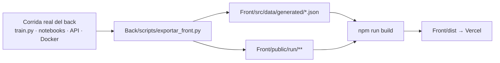

# 07 · Libreto del front (v2.0.0)

> **Para:** quien mantenga o presente el front. El front es un sitio **100 % estático y autónomo** (ADR-004): no llama
> a la API ni a ningún otro origen. Reproduce con fidelidad la corrida real del back a partir de un **paquete de
> corrida** precargado, y calcula en el navegador con un **port exacto** del modelo servido.

## 1. Cómo se produce y se publica



1. Después de cualquier corrida del back, ejecute `python Back/scripts/exportar_front.py` y haga commit de su salida.
2. `npm --prefix Front run build` construye el sitio. Si un archivo opcional falta, la página degrada con elegancia y el build no falla.
3. `tests/test_contratos.py` (Python) comprueba que los hashes del manifest coinciden y que los casos golden siguen siendo los del artefacto servido. Así, si alguien reentrena sin volver a exportar, la prueba lo detecta.

## 2. Contrato del paquete de corrida

| Archivo | Origen (back) | Lo usa |
|---|---|---|
| `generated/model_card.json` | `train.py` | Portada, capítulos 8 y 11, consola API |
| `generated/modelo_export.json` | `ArtefactoModelo` (pipeline, coeficientes, sigmoide, umbrales, explicador) | `engine/scoring.ts` → simulador y consola |
| `generated/texto_export.json` | `ArtefactoTexto` (vocabulario, idf, coeficientes, léxico) | `engine/texto.ts` |
| `generated/golden.json` | 303 clientes de test (60 con faltantes) + 3 demo + 50 textos con las salidas de Python | Solo pruebas (excluido del bundle) |
| `generated/clientes_demo.json` | `credit_risk.demo` (bajo → aprobar, medio → revisar, alto → rechazar) | Simulador, consola |
| `generated/agregados.json` | Consultas DuckDB sobre el CSV y los procesados | Capítulos 2–4, explorador |
| `generated/api_capturas.json` | Peticiones reales a la API (`TestClient`), con latencia, X-Request-ID y `openapi` | Consola API (capítulo 10) |
| `generated/docker_api.json` | Transcripción real de `docker compose` (build, up, health, predict, logs) | Pestaña Docker |
| `generated/train_log.json` | `train.py --log` (segundo real de cada línea) | `RunTerminal` (capítulo 8) |
| `generated/resultados_{clasicos,dl,nlp,spark}.json` | Notebooks 05, 06, 07 y 09 (esquemas en `data/schemas`) | Capítulos 5–9 y 11 |
| `generated/gestion.json` · `dod_status.json` · `ejecuciones.json` | `generar_evidencia.py` · `verificar_dod.py` · cola de papermill | Metodología, trazabilidad, rail |
| `generated/manifest.json` | Versión, git sha, fecha y SHA-256 de cada archivo | Pie del sitio y pruebas |
| `public/run/data/*.csv` | Crudo (12.144 filas), train (9.600) y test (2.400), copiados tal cual | `DataExplorer` (worker, una sola carga) |
| `public/run/nube_pca.json` | PCA 2D real de 12.000 clientes con su decisión | Portada |
| `public/run/notebooks/NN.json` + `img/*.webp` | Notebooks ejecutados: celdas, salidas y duración real por celda | `NotebookPlayer` |
| `public/run/figuras.json` | 139 especificaciones de figura adjuntas con `figura_front()` en los notebooks | Capítulos (figuras nativas) y paleta Ctrl+K |

**Figuras:** los gráficos de matplotlib son solo referencia. Cada figura viaja con sus datos exactos (MIME `application/vnd.creditrisk.figura+json`) y se redibuja con `charts/Figura.tsx`.

## 3. Motores exactos

| Motor | Reproduce | Verificación |
|---|---|---|
| `src/engine/scoring.ts` | Variables derivadas, capping p1-p99, imputación, escalado, One-Hot y ordinal, LR, sigmoide, regla de Chow y contribuciones exactas en log-odds | `scoring.test.ts`: \|Δp\| < 1e-6 en 303 casos; las contribuciones suman el logit (< 1e-9) |
| `src/engine/texto.ts` | Normalización, tokens con `\b` de Python, stopwords, 1-2 gramas, TF-IDF con norma L2, LR calibrada y léxico | \|Δp\| < 1e-6 en 50 textos, misma banda y sentimiento |
| `features/api/validacion.ts` | Validación de `ClienteRequest` (Pydantic v2: rangos, literales, `extra="forbid"`) con el 422 en el formato de FastAPI | `validacion.test.ts` frente a las capturas reales |

## 4. Mapa del sitio

| Ruta | Contenido |
|---|---|
| `/` | Pregunta central "¿Pagará?", nube PCA real, KPIs v2, política de Chow interactiva y recorrido 2 módulos → 5 unidades → 12 entregables |
| `/metodologia` (paso 0) | Scrum + CRISP-DM, kanban, sprints con burndown calculado desde git, DoD/DoR, 8 ADR, lecciones aprendidas, riesgos y estado de la DoD |
| `/paso/1` … `/paso/11` | Una ficha por entregable: actividades → reproductor del notebook → figuras nativas con evidencia → lo que aprendimos → criterio de hecho |
| `/simulador` | 19 campos, medidor, decisión, cascada de contribuciones, análisis del texto, "¿qué pasa si…?" y la petición/respuesta de la API |
| `/trazabilidad` | Matriz ID del enunciado → HU → paso → evidencia → estado, con el conteo calculado |

## 5. Verificación

```bash
npm --prefix Front test                 # Vitest: motores (golden), figuras, reproductor, validación, simulador, capítulos
PW_CHROMIUM=<ruta a chrome-headless-shell> npx --prefix Front playwright test   # e2e escritorio + móvil, back apagado, 0 peticiones externas
```

## 6. Guion de demo (5 minutos)

| Tiempo | Acción | Qué mostrar |
|---|---|---|
| 0:00 | Portada | "¿Pagará?" y la nube real de 12.000 clientes: cambiar el modo a "Impago real" y separar grupos. Leer los KPIs: AUC 0,846, aprobar 39,7 % y 9,8 % de impago entre los aprobados. |
| 0:40 | Mover la aguja de la política | Los umbrales salen de los costos (0,178 y 0,467), no del modelo. |
| 1:10 | `/metodologia` | Kanban real, burndown desde los commits, la DoD automatizada (10/10 notebooks) y los ADR. |
| 1:50 | `/paso/5` → **Ejecutar todo** | El reproductor corre nb05 celda a celda con sus salidas y tiempos reales, y las figuras se redibujan de forma nativa. |
| 2:40 | `/paso/8` | Calibración (honesta: ya estaba calibrada), precio de la equidad (DI por edad 0,72 → 0,89) y los tres casos explicados. |
| 3:20 | `/simulador` | Clientes demo bajo, medio y alto (aprobar, revisar, rechazar); mover "uso de cupo" y ver la cascada; abrir "Petición / Respuesta". |
| 4:10 | `/paso/10` | Consola API: reproducir `/predict`, probar `edad = 999` (422 idéntico a FastAPI) y ver la pestaña Docker. |
| 4:40 | `/trazabilidad` | El checklist del enunciado se calcula, no se marca a mano. |
