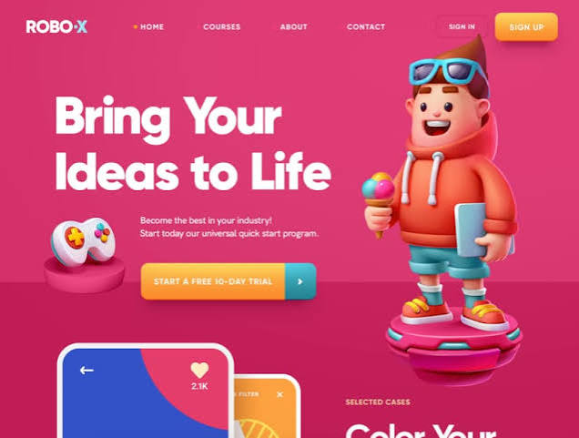

# Análisis de estilos de referencia

Tres referencias, tres estilos muy distintos. Los colores en hex los saqué muestreando píxeles de las imágenes, así que son fieles. Las tipografías están marcadas como **confirmada** (leída del CSS real) o **estimada** (identificada a ojo).

## Resumen rápido

| | 1. ROBO-X | 2. itworking (BOWWE) | 3. Norebro |
|---|---|---|---|
| **Estilo** | Ilustración 3D *playful* / vibrante | *Dark mode* con gradientes (tech / glass) | Portafolio oscuro editorial |
| **¿Minimalista?** | No en el color; sí en la estructura | Semiminimalista | Sí (minimalismo oscuro) |
| **Fondo** | Color sólido saturado en 2 bandas | Degradado oscuro azul → violeta | Fotografía + panel oscuro |
| **Tipografía** | Sans geométrica ExtraBold, tipo Gilroy (estimada) | Sans geométrica SemiBold, tipo Montserrat (estimada) | Poppins + Rubik (confirmada) |
| **De dónde sale el color** | Del fondo y los personajes 3D | De las formas con gradiente | De la fotografía |
| **CTA principal** | Botón con gradiente naranja y brillo | Botón negro sobrio | Enlace de texto |
| **Sensación** | Divertida, juvenil, con energía | Moderna, tech, aspiracional | Elegante, sobria, premium |
| **Ideal para** | Cursos, edtech, gaming, apps para niños | SaaS, empleo tech, startups | Portafolios, estudios, arquitectura, interiorismo |

---

## 1. ROBO-X — Ilustración 3D *playful*



### Qué estilo es
**Ilustración 3D cartoon** (lo que en Dribbble llaman *3D illustration* o *claymorphism*) sobre un **fondo de color plano muy saturado**. Es lo contrario del minimalismo en cuanto a color, pero la estructura es limpia: un titular, una frase, un botón y un personaje. Parece un concepto de diseño (un *shot* de Dribbble/Behance) más que un sitio en producción, así que no hay CSS que consultar.

La idea central: **un solo tono dominante (rosa frambuesa) con acentos complementarios** (naranja, teal, azul). Todo el texto va en blanco; el color lo ponen el fondo y los objetos.

### Paleta

| Rol | Hex | Nota |
|---|---|---|
| Fondo del hero | `#DB3972` | Rosa frambuesa (varía entre `#D7326C` y `#E03B75`) |
| Banda inferior ("piso") | `#C21D57` | Un tono más oscuro del mismo rosa |
| CTA, inicio del gradiente | `#FAC251` | Amarillo |
| CTA, final del gradiente | `#F88F2F` | Naranja |
| Acento teal | `#43B4C7` | Segmento de la flecha del CTA, la X del logo |
| Acento azul | `#3352C7` | Fondo de las cards |
| Punto del menú activo | `#ED6F46` | Coral |
| Texto | `#FFFFFF` | Siempre blanco |

### Tipografía (estimada)
- **Familia:** sans geométrica muy gruesa y redondeada. Se parece mucho a **Gilroy ExtraBold** (comercial). Alternativas gratis en Google Fonts: **Outfit 800**, **Urbanist 800** o **Plus Jakarta Sans 800**.
- **Titular (H1):** "Bring Your / Ideas to Life". En Title Case, peso 800, interlineado muy apretado (~1.05) y *tracking* un poco negativo. Es enorme: ocupa casi la mitad del ancho. Algo como `clamp(48px, 8vw, 120px)`.
- **Menú:** misma familia en MAYÚSCULAS, 11–12 px, bold, `letter-spacing: 0.1em`.
- **Párrafo:** misma familia, regular, 15–16 px, blanco al ~90 %.
- **Eyebrow:** "SELECTED CASES", en mayúsculas pequeñas y naranja, encima de un titular grande blanco.

### Layout
- **Hero a dos columnas:** el texto a la izquierda (~55 %) y el personaje 3D a la derecha.
- **El fondo se parte en dos bandas horizontales.** La de abajo, más oscura, hace de "suelo" o escenario: el personaje y el mando descansan sobre pedestales apoyados en ella. Da profundidad sin usar gradientes.
- **El personaje rompe la cuadrícula:** baja más allá del hero y se mete en la sección siguiente.
- **Objetos 3D pequeños flotando** (el mando) para llenar el espacio negativo junto al texto.
- **La sección siguiente asoma** (las cards de teléfono y "Color Your…"), lo que invita a hacer scroll.

### Componentes
- **Logo:** wordmark bold "ROBO·X", con la X en teal.
- **Menú:** el ítem activo lleva un punto coral a la izquierda.
- **"SIGN IN" (secundario):** botón *ghost*, fondo apenas distinto del rosa, radio ~8 px.
- **"SIGN UP" (primario):** gradiente vertical amarillo → naranja, radio ~10 px y **sombra de color naranja**, no gris.
- **CTA dividido:** el cuerpo naranja con el texto en mayúsculas más un segmento teal con flecha ▸ a la derecha.
- **Cards:** radio grande (~24 px), borde blanco grueso (~6 px) como si fueran un móvil, fondos de color sólido cortados por formas (un círculo rosa sobre azul) y un badge "♥ 2.1K".

### Claves para reproducirlo
1. **Los recursos 3D son el 80 % del efecto.** Opciones: packs de personajes 3D (IconScout, Freepik), modelarlos en Spline o generarlos con IA y quitarles el fondo. Expórtalos como PNG o WebP transparente.
2. **Sombras de color:** `box-shadow` con el rgba del propio botón, nunca gris.
3. **Pocos colores muy saturados** y todo el texto en blanco.

```css
:root {
  --bg: #DB3972;
  --bg-floor: #C21D57;
  --cta-from: #FAC251;
  --cta-to: #F88F2F;
  --accent-teal: #43B4C7;
  --accent-blue: #3352C7;
  --text: #FFFFFF;
  --radius-btn: 10px;
  --radius-card: 24px;
  --font: "Outfit", "Gilroy", sans-serif;
}
.btn-primary {
  background: linear-gradient(180deg, var(--cta-from), var(--cta-to));
  border-radius: var(--radius-btn);
  box-shadow: 0 10px 24px rgb(248 143 47 / .45); /* sombra de color */
}
```

---

## 2. itworking (BOWWE) — *Dark mode* con gradientes


> El marco verde difuminado con "GRADIENT" y "SOURCE: BOWWE…" es la presentación del artículo de BOWWE sobre tendencias. **El sitio es solo la captura del centro.**

### Qué estilo es
**Dark mode con gradientes**: un fondo oscuro azul-violeta y formas abstractas rellenas de gradientes suaves (*mesh gradients*), con un toque de *glassmorphism* por el brillo que tienen. Es la estética típica de SaaS y tech actual. En contenido es **semiminimalista** (poco texto, mucho aire), pero las formas le dan riqueza visual.

### Paleta

| Rol | Hex | Nota |
|---|---|---|
| Fondo, esquina superior izquierda | `#212331` | Casi negro azulado |
| Fondo, centro | `#2C2C4C` | Índigo oscuro |
| Fondo, esquina inferior derecha | `#5749AA` | Violeta: el degradado va en diagonal |
| Forma 1, zona brillante | `#CB66FE` → `#B56EF8` | Magenta-violeta |
| Forma 1, brillo inferior izquierdo | `#C0A9DC` | Lavanda claro, como un reflejo de luz |
| Forma 1, zona oscura | `#6B44BD` | Violeta profundo |
| Forma 2 | `#482195` → `#6E67E2` | Violeta oscuro a lavanda |
| Texto | `#FFFFFF` | Párrafo al ~72 % de opacidad |
| Botón | `#0B0B10` | Negro con un borde blanco sutil |
| Enlace dentro del texto | violeta claro | La palabra "here" del párrafo |

### Tipografía (estimada)
- **Familia:** sans geométrica en SemiBold (600). Se ve como **Montserrat** o **Raleway**; no pude confirmarla porque la página de BOWWE no expone sus fuentes. Alternativa equivalente: **Poppins 600**.
- **H1:** "We're / looking for" en dos líneas, ~80 px en escritorio, interlineado ~1.1. En CSS: `clamp(40px, 6vw, 88px)`.
- **Palabra clave en píldora:** "Software developers" va dentro de una píldora con borde (1 px blanco al ~30 %, `border-radius: 999px`), a ~30 px. **Es el recurso más reconocible de este diseño:** la palabra que cambia según el puesto queda enmarcada.
- **Menú:** 13–14 px, regular, blanco al ~80 %. Lleva un selector de idioma "EN ▾".
- **Párrafo:** 14 px, blanco al ~72 %.

### Layout
- **Dos columnas 50/50.** El texto a la izquierda, centrado en vertical.
- **A la derecha, una rejilla 2×2 en ajedrez:** forma abstracta, foto circular, foto circular, forma abstracta, con ~16–20 px de separación.
- **Las formas abstractas son *squircles*** (cuadrados con esquinas muy redondeadas, radio ~25–30 % del lado).
- **Retratos recortados en círculo**, con un anillo de luz claro alrededor y un fondo violeta detrás: la foto queda dentro de la paleta.
- Menú fino arriba y mucho espacio negativo.

### Claves para reproducirlo
1. **Las formas son solo CSS:** un `linear-gradient` de base más un `radial-gradient` encima para el brillo. Si quieres más profundidad, añade un `box-shadow: inset` claro arriba.
2. **Las fotos tienen que encajar con la paleta:** gente sonriente, tonos fríos y fondo recortado sobre violeta.
3. **Contraste por luminosidad:** el fondo, oscuro y apagado, a la izquierda; las formas, saturadas y luminosas, a la derecha.

```css
:root {
  --bg: linear-gradient(135deg, #212331 0%, #2C2C4C 45%, #5749AA 100%);
  --shape-a: radial-gradient(circle at 15% 85%, #F1D6F5 0%, transparent 55%),
             linear-gradient(225deg, #CB66FE 0%, #9C5BEF 50%, #6B44BD 100%);
  --shape-b: linear-gradient(160deg, #482195 0%, #6E67E2 100%);
  --text: #FFFFFF;
  --text-muted: rgb(255 255 255 / .72);
  --btn: #0B0B10;
  --font: "Montserrat", sans-serif;
}
.squircle { aspect-ratio: 1; border-radius: 28%; background: var(--shape-a); }
.pill     { border: 1px solid rgb(255 255 255 / .3); border-radius: 999px; padding: .2em .7em; }
```

---

## 3. Norebro — Portafolio oscuro editorial


### Qué estilo es
Es **Norebro**, un tema de WordPress de **Colabrio** (se vende en ThemeForest). Esta es su demo de portafolio creativo. Su estilo es **minimalismo oscuro editorial**: un slider fotográfico a pantalla completa con un panel oscuro semitransparente encima del texto y un **marco fijo** alrededor (barras laterales con controles). Paleta casi monocromática: **la jerarquía sale solo del tamaño y de la opacidad del blanco**, y el único color lo pone la foto.

### Paleta

| Rol | Hex | Nota |
|---|---|---|
| Panel del texto | `#343434` | Oscuro al ~90 % sobre la foto |
| Barra lateral | `#393939` | Marco fijo |
| Número fantasma "01/05" | `#414141` | Apenas se distingue del panel (blanco al ~6 %), es decorativo |
| Foto | grises + verde apagado `#9BA799` | Desaturada y oscurecida |
| Títulos | `#FFFFFF` | |
| Párrafo | ~`#9A9A9A` | Gris medio |
| Acento del tema | `#505CFD` | No sale en este hero; el tema lo usa en hovers y detalles |

### Tipografía (confirmada en el CSS del tema)
- **Títulos: Poppins.** Aquí en Medium (500), ~56 px en escritorio, interlineado ~1.1, `letter-spacing: -0.02em`.
- **Cuerpo: Rubik**, regular, 14–15 px, gris, interlineado ~1.7.
- **Etiqueta "DESIGN":** píldora con borde blanco, 9–10 px, mayúsculas bold.
- **"View Project":** semibold, 14 px, blanco. Es un enlace, no un botón.
- **Contador "01/05":** Poppins a ~64 px, casi invisible.
- **Texto vertical** en la barra izquierda ("© NOREBRO THEME BY COLABRIO"): rotado −90°, 9 px, mayúsculas con *tracking* amplio.

### Layout
- **Slider a pantalla completa** (`100vh`) con la foto de fondo.
- **El panel oscuro cubre ~40 % a la izquierda**, y **el titular se sale del panel** y pisa la foto. Es intencional: une las dos zonas.
- **Marco perimetral fijo:**
  - Barra izquierda (~45 px): hamburguesa arriba, texto vertical en el medio, "Share +" abajo.
  - Logo "Norebro" junto a la hamburguesa.
  - Arriba a la derecha: redes sociales (f, tw, ig).
  - Derecha, al centro: paginación vertical del slider.
  - Abajo a la derecha: flechas anterior/siguiente en círculos oscuros (~36 px).
  - Abajo, al centro: indicador "Scroll" con una línea.
- **Contenido alineado a la izquierda** y centrado en vertical.

### Claves para reproducirlo
1. **La fotografía lo es todo:** que sea de calidad, desaturada y oscurecida con un overlay negro del 30–50 %.
2. **Monocromo disciplinado:** sin colores de UI; solo blanco a distintas opacidades sobre grises.
3. **Detalles editoriales:** textos verticales, numeración grande y fantasma, indicador de scroll, controles en los bordes.
4. **El slider:** Swiper.js con transición de fundido o deslizamiento.

```css
:root {
  --panel: rgb(45 45 45 / .9);     /* ≈ #343434 sobre la foto */
  --frame: #393939;
  --text: #FFFFFF;
  --text-muted: #9A9A9A;
  --ghost: rgb(255 255 255 / .06); /* "01/05" */
  --accent: #505CFD;
  --font-title: "Poppins", sans-serif;
  --font-body: "Rubik", sans-serif;
}
.vertical-text { writing-mode: vertical-rl; transform: rotate(180deg); letter-spacing: .15em; }
.counter       { font: 500 64px/1 var(--font-title); color: var(--ghost); }
```

---

## Lo que comparten (y lo que no)

**Comparten:**
- **Sans geométrica en los tres** (tipo Gilroy, tipo Montserrat y Poppins). Es el denominador común de la web moderna.
- **Hero de dos zonas:** el texto alineado a la izquierda y el elemento visual a la derecha.
- **Muy poco texto en el hero:** titular, una frase y una sola acción.

**Se diferencian en tres decisiones**, que son las que definen cada estilo:
1. **De dónde sale el color:** del fondo saturado (ROBO-X), de las formas con gradiente (itworking) o de la fotografía (Norebro).
2. **Cuánto pesa el CTA:** un botón llamativo con brillo, un botón negro discreto o un simple enlace de texto. A más elegancia, menos botón.
3. **El peso de la fuente:** ExtraBold (divertido), SemiBold (moderno) o Medium (sofisticado).

## Palabras clave para buscar más referencias
- **Estilo 1:** `3D illustration landing page`, `claymorphism website`, `playful edtech hero`
- **Estilo 2:** `dark gradient landing page`, `mesh gradient UI`, `glassmorphism SaaS hero`
- **Estilo 3:** `dark portfolio slider`, `creative agency fullscreen slider`, `editorial minimal dark website`

## Fuentes
- Hoja de estilos de Norebro (fuentes y colores confirmados): <https://sprint.elifesciences.org/wp-content/themes/norebro/style.css%3Fver=5.9.2.css>
- Norebro en ThemeForest: <https://themeforest.net/item/norebro-creative-multipurpose-wordpress-theme/20834703>
- Plantilla de BOWWE: <https://bowwe.com/preview/landing-page/enrollment/en>
